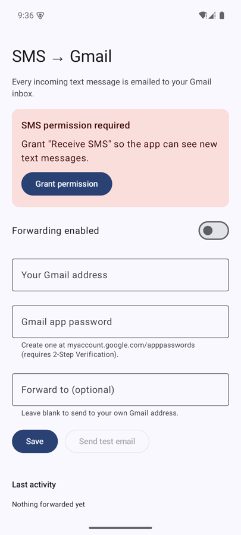

# SMS → Gmail (AutoMsgForward)

An Android app that forwards every text message your phone receives to your Gmail inbox, automatically.

Use it to read one-time codes and bank alerts on your computer, to keep a searchable archive of your texts in Gmail,
or to get the texts from a second SIM or a spare phone you leave at home.



## Features

- **Automatic:** forwards each new SMS in the background, even when the app is closed.
- **Reliable:** if the phone is offline, the message waits for a connection and is retried (up to 10 tries, with growing delays).
- **Complete:** long texts that arrive in several parts are joined back into one email.
- **No duplicates:** a text the system delivers twice is only emailed once.
- **Secure:** your Gmail app password is encrypted with a key held in the Android Keystore. Mail goes over TLS to `smtp.gmail.com`.
- **No servers:** the app talks only to Gmail. There is no backend, account or analytics.

Each email looks like this:

```
Subject: SMS from +15551234: Your verification code is 482913. Do no…

From: +15551234
Received: 2026-11-11 21:48:07 PST
Device: Google Pixel 7

Your verification code is 482913. Do not share it.
```

## Install

1. Download `AutoMsgForward-<version>.apk` from the [latest release](../../releases/latest) on your Android phone (Android 8.0 or newer).
2. Open it. If Android asks, allow your browser or file manager to **install unknown apps**.

> The APK is signed with a debug key and is meant for personal sideloading. It is not on the Play Store:
> Google Play only allows SMS permissions for apps that are the default SMS app.

## Set up

### 1. Create a Gmail app password

The app signs in to Gmail with an **app password**, not your normal password.

1. Turn on [2-Step Verification](https://myaccount.google.com/signinoptions/two-step-verification) for your Google account (app passwords require it).
2. Go to <https://myaccount.google.com/apppasswords>, enter a name such as `SMS forwarder`, and click **Create**.
3. Copy the 16-letter password. Spaces don't matter; the app removes them.

### 2. Configure the app

1. Open **SMS → Gmail** and tap **Grant permission**, then **Allow** (the app needs the *Receive SMS* permission).
2. Enter **Your Gmail address** and the **Gmail app password**.
3. *(Optional)* Enter a different **Forward to** address. Leave it blank to send the emails to yourself.
4. Tap **Send test email** and check that it arrives (look in Spam too).
5. Turn on **Forwarding enabled** and tap **Save**.

You're done. The **Last activity** line at the bottom shows the result of the most recent forward.

### 3. Keep it running (important on some phones)

Phones from Xiaomi, Huawei, Samsung, OnePlus and some others stop background apps aggressively. To keep forwarding reliable:

- **Settings → Apps → SMS → Gmail → Battery → Unrestricted**
- On Xiaomi/MIUI, also turn on **Autostart** for the app.

## Troubleshooting

| What you see | What to do |
| --- | --- |
| "Gmail rejected the login" | Check the address, and create a new app password. 2-Step Verification must be on. |
| **Send test email** is greyed out | The Gmail address, app password or "Forward to" address is missing or invalid. |
| Test works but texts aren't forwarded | Check that **Forwarding enabled** is on and saved, that the SMS permission is granted, and that battery mode is *Unrestricted*. |
| Status says "Retrying" | The phone has no internet, or Gmail is unreachable. It will retry on its own. |
| Some messages never arrive | RCS / chat messages (the "Chat" feature in Google Messages) are not SMS and are not forwarded. |

To stop forwarding, turn off **Forwarding enabled** and tap **Save**, or uninstall the app.
If you no longer use the app, also revoke its app password at <https://myaccount.google.com/apppasswords>.

## Limits

- Very long texts are cut off at 2,500 characters.
- Only SMS is forwarded. MMS (pictures) and RCS chat messages are not.

## Build from source

You need JDK 17 or newer and the Android SDK (Android Studio is the easiest way to get both).

```bash
./gradlew testDebugUnitTest   # run unit tests
./gradlew assembleDebug       # build app/build/outputs/apk/debug/app-debug.apk
./gradlew installDebug        # install on a connected device or emulator
```

### Testing on an emulator

Send a fake text to a running emulator:

```bash
adb emu sms send 5551234 "Your verification code is 482913"
```

Or use the emulator's **⋯ → Phone → Send message**.

If clicking a text field shows a small floating toolbar instead of the keyboard, the emulator is treating your
mouse as a stylus and Android has opened handwriting mode. Turn it off with:

```bash
adb shell settings put secure stylus_handwriting_enabled 0
```

## How it works

```
SMS_RECEIVED broadcast ──► SmsReceiver ──► ForwardWorker (WorkManager) ──► GmailSender ──► smtp.gmail.com:587
                          joins parts      waits for network, retries      STARTTLS + app password
```

| File | Role |
| --- | --- |
| `sms/SmsReceiver.kt` | Receives the system broadcast and joins multipart messages |
| `mail/ForwardWorker.kt` | Background job: builds the email, sends it, retries on failure |
| `mail/GmailSender.kt` | SMTP client (JavaMail for Android) |
| `mail/EmailContent.kt` | Formats the subject and body |
| `data/SettingsRepository.kt` | Stores settings; the app password is encrypted via `SecretCipher.kt` |
| `ui/SettingsScreen.kt` | The settings screen (Jetpack Compose) |
