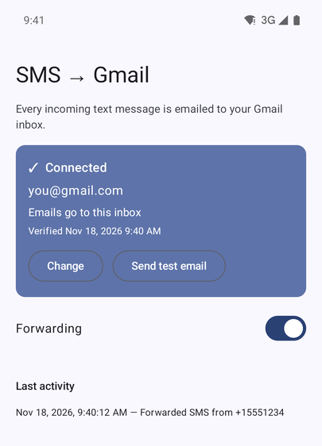

# SMS → Gmail（AutoMsgForward）

[English](README.md) | 简体中文

一款 Android 应用，自动把手机收到的每一条短信转发到你的 Gmail 邮箱。

可以用来在电脑上查看验证码和银行通知，在 Gmail 里保存一份可搜索的短信存档，
或者接收第二张 SIM 卡、留在家里的备用手机上的短信。



> 应用界面目前只有英文。下文中按钮和选项名称保留英文原文，便于对照。

## 功能

- **自动：** 在后台转发每一条新短信，即使应用已关闭。
- **可靠：** 手机离线时，短信会等待联网后再发送，并自动重试（最多 10 次，间隔逐渐加长）。
- **补发遗漏：** 如果短信到达时应用没有运行（例如手机刚重启），应用下次启动时会从收件箱中找出并转发。
- **重启后自动运行：** 手机重启后应用会自动启动并在后台持续运行，
  通知栏会显示一条静默通知 *Forwarding texts to Gmail*。
- **自动恢复：** 每 15 分钟检查一次，如果应用被系统杀掉，会重新开始转发，并补发期间收到的短信。
- **完整：** 分成多段送达的长短信会重新拼接成一封邮件。
- **不重复：** 系统重复投递的同一条短信只会发送一次邮件。
- **安全：** Gmail 应用专用密码使用 Android Keystore 中的密钥加密保存。邮件通过 TLS 发送到 `smtp.gmail.com`。
- **无服务器：** 应用只与 Gmail 通信，没有后端、账号或统计分析。

每封邮件的样子：

```
Subject: SMS from +15551234: Your verification code is 482913. Do no…

From: +15551234
Received: 2026-11-11 21:48:07 PST
Device: Google Pixel 7

Your verification code is 482913. Do not share it.
```

## 安装

1. 在 Android 手机（Android 8.0 或更高版本）上，从 [最新版本](../../releases/latest) 下载 `AutoMsgForward-<版本号>.apk`。
2. 打开安装包。如果系统提示，请允许浏览器或文件管理器 **安装未知应用**。

> APK 使用调试密钥签名，仅供个人侧载使用，未上架 Play 商店：
> Google Play 只允许默认短信应用申请短信权限。

## 设置

### 1. 创建 Gmail 应用专用密码

应用使用 **应用专用密码**（app password）登录 Gmail，而不是你的普通密码。

1. 为你的 Google 账号开启 [两步验证](https://myaccount.google.com/signinoptions/two-step-verification)（应用专用密码需要它）。
2. 打开 <https://myaccount.google.com/apppasswords>，输入一个名称（例如 `SMS forwarder`），点击 **Create**（创建）。
3. 复制生成的 16 位字母密码。空格无所谓，应用会自动去掉。

### 2. 配置应用

1. 打开 **SMS → Gmail**，点击 **Grant permission**，然后在每个弹窗中点 **允许**。应用需要短信权限
   （用于接收新短信，以及从收件箱读取遗漏的短信）和通知权限（用于显示"正在运行"通知）。
2. 填写 **Your Gmail address**（你的 Gmail 地址）和 **Gmail app password**（应用专用密码）。
3. *（可选）* 在 **Forward to** 中填写另一个收件地址。留空则发送给你自己。
4. 点击 **Save**（保存）。表单会收起为一张显示账号的卡片，**Forwarding**（转发）开关自动打开。
5. 点击 **Send test email**（发送测试邮件），确认邮件已收到（也请检查垃圾邮件）。卡片会变为 **✓ Connected**。

设置完成。顶部的卡片会始终显示账号状态：

| 卡片 | 含义 |
| --- | --- |
| **Not set up** | 还没有保存账号。 |
| **Saved, not verified yet** | 已保存，但 Gmail 还没有确认过登录。请发送一封测试邮件。 |
| **✓ Connected** | Gmail 接受了最近一次测试邮件或转发，并显示验证时间。 |
| **✕ Gmail rejected the login** | 短信没有被转发。点击 **Change** 并输入新的应用专用密码。 |
| **Forwarding is off** | **Forwarding** 开关已关闭。 |

要更换账号或应用专用密码，点击 **Change**。更改任意一项都会让卡片回到 *Saved, not verified yet*。
底部的 **Last activity** 显示最近一次转发的结果。
转发开启期间，通知栏会一直有一条静默的 **Forwarding texts to Gmail** 通知。
它让应用保持运行，系统才会继续把短信交给应用；你可以把它折叠，但不要屏蔽它。

### 3. 允许后台运行（大多数手机都需要）

很多手机为了省电会暂停或阻止后台应用。这种情况下，锁屏时收到的短信会被**扣住，直到你下次打开应用才转发**。
请完成以下所有步骤：

1. **允许后台运行。** 在应用中点击 *Allow running in background* 卡片里的 **Allow** 并确认。
   这会把应用移出电池优化。
2. **开启自启动**（一加、OPPO、realme、小米、vivo、华为、荣耀）。在应用中点击
   **App settings**（或进入 **设置 → 应用 → 应用管理 → SMS → Gmail**），然后：
   - **耗电管理 → 允许后台活动** → 开启
   - **允许自启动** → 开启
3. **保持 Wi-Fi 或移动数据开启。** 离线时收到的短信会排队，联网后自动发送。
4. **不要从最近任务中划掉应用。** 在这些手机上，划掉等于强行停止。
   稳妥起见，可以把它锁定：打开最近任务界面，下拉（或长按）应用卡片，点 🔒。

然后锁屏，等几分钟，给自己发一条短信，确认它能立即被转发。

<details>
<summary>其他手机上的设置位置</summary>

| 手机 | 电池 | 自启动 |
| --- | --- | --- |
| 一加 / OPPO / realme（ColorOS、OxygenOS） | 应用信息 → 耗电管理 → **允许后台活动** | 应用信息 → 耗电管理 → **允许自启动** |
| 小米 / 红米 / POCO（MIUI、澎湃 HyperOS） | 应用信息 → 省电策略 → **无限制** | 应用信息 → **自启动** |
| vivo / iQOO（OriginOS、Funtouch） | 设置 → 电池 → 后台耗电管理 → **允许** | i 管家 → 应用管理 → **自启动** |
| 华为 / 荣耀（EMUI、MagicOS） | 设置 → 电池 → 启动管理 → 关闭 **自动管理**，再打开全部三个开关 | （在同一界面） |
| 三星（One UI） | 应用信息 → 电池 → **不受限制** | 不需要 |
| Pixel 及其他原生 Android | 应用信息 → 应用的电池用量 → **不受限制** | 不需要 |

不同系统版本的菜单名称会变化；找不到时，可以在设置中搜索"自启动"、"自动启动"或"后台"。
网站 <https://dontkillmyapp.com> 有按机型整理的详细说明。
</details>

**为什么需要这些设置：** 在一加 13（ColorOS 16）上，系统日志显示 ColorOS 会在熄屏约 10 秒后冻结应用，
并且其自启动管理器拒绝把新短信交给应用（`OplusAppStartupManager: prevent start … SMS_RECEIVED`）。
直到打开应用，这些短信才被送达。应用无法自行获得这些豁免，只能在系统设置中手动开启。

第二次测试发现，ColorOS 只会把短信交给进程正在运行的应用
（`OplusAppStartupManager: skip broadcast for proc does not exist … SMS_RECEIVED`）。被冻结的进程没有问题，
但手机夜间重启后进程不存在，所有短信都被跳过了。因此应用会在重启后自动启动、保持一个前台服务运行，
并从收件箱读取遗漏的短信。重启后 ColorOS 仍会把应用的启动推迟几分钟；在这段时间内到达的短信，
会在应用启动后由收件箱补发功能转发。

## 常见问题

| 现象 | 处理方法 |
| --- | --- |
| 红色卡片："Gmail rejected the login" | 点击 **Change**，检查地址，并输入新的应用专用密码。必须开启两步验证。 |
| 卡片一直停在 "Saved, not verified yet" | 点击 **Send test email**。如果因网络错误失败，请检查网络后重试。 |
| **Send test email** 或 **Save** 是灰色的 | Gmail 地址、应用专用密码或 "Forward to" 地址缺失或无效。没有修改任何内容时 **Save** 也会保持灰色。 |
| 测试邮件正常，但短信没有被转发 | 确认 **Forwarding** 开关已打开，并且已授予短信权限。 |
| 状态显示 "Queued … sends when the phone is online" | 手机没有网络。打开 Wi-Fi 或移动数据后，排队的短信会自动发送。 |
| 只有打开应用或亮屏时短信才被转发 | 手机在后台暂停了应用。请完成 [允许后台运行](#3-允许后台运行大多数手机都需要) 中的每一步，尤其是 **自启动**，并且不要划掉应用。 |
| 状态显示 "Retrying" | 手机没有网络，或无法连接 Gmail。应用会自动重试。 |
| 部分消息始终没有收到 | RCS / 聊天消息（Google Messages 中的"聊天"功能）不是短信，不会被转发。 |

要停止转发，关闭 **Forwarding** 开关，或卸载应用。
如果不再使用本应用，也请在 <https://myaccount.google.com/apppasswords> 撤销它的应用专用密码。

## 限制

- 手机重启后，Android 会扣住所有新短信，直到你第一次解锁。解锁后不久它们就会被转发（在 ColorOS 上需要几分钟）。
- 收件箱补发只能看到短信应用保存在系统标准短信收件箱里的短信。有些短信应用会隐藏或自动删除一次性验证码；
  如果这类短信在应用未运行时到达，就无法找回。
- 首次授予短信权限后，只会转发此后收到的短信，不会转发旧短信。
- 超长短信会在 2,500 个字符处截断。
- 只转发短信（SMS）。彩信（图片）和 RCS 聊天消息不会被转发。

## 从源码构建

需要 JDK 17 或更高版本，以及 Android SDK（安装 Android Studio 是获取两者最简单的方法）。

```bash
./gradlew testDebugUnitTest   # 运行单元测试
./gradlew assembleDebug       # 构建 app/build/outputs/apk/debug/app-debug.apk
./gradlew installDebug        # 安装到已连接的设备或模拟器
```

### 在模拟器上测试

向正在运行的模拟器发送一条模拟短信：

```bash
adb emu sms send 5551234 "Your verification code is 482913"
```

也可以使用模拟器的 **⋯ → Phone → Send message**。

如果点击输入框时出现一个小的浮动工具栏而不是键盘，说明模拟器把鼠标当作手写笔，并打开了手写模式。
可以这样关闭：

```bash
adb shell settings put secure stylus_handwriting_enabled 0
```

## 工作原理

```
SMS_RECEIVED 广播 ──► SmsReceiver ──► ForwardWorker (WorkManager) ──► GmailSender ──► smtp.gmail.com:587
                     拼接多段短信       等待联网，失败重试               STARTTLS + 应用专用密码
```

| 文件 | 作用 |
| --- | --- |
| `sms/SmsReceiver.kt` | 接收系统广播并拼接多段短信 |
| `sms/InboxCatchUp.kt`、`sms/CatchUp.kt` | 每次应用启动时，转发应用未运行期间到达收件箱的短信 |
| `service/KeepAliveService.kt` | 前台服务，保持进程存活，让系统持续把短信交给应用 |
| `service/BootReceiver.kt` | 手机重启或应用更新后启动服务 |
| `service/WatchdogWorker.kt` | 每 15 分钟检查一次：服务被杀时重新启动，并补发遗漏的短信 |
| `mail/ForwardWorker.kt` | 后台任务：生成邮件、发送，失败时重试 |
| `mail/GmailSender.kt` | SMTP 客户端（JavaMail for Android） |
| `mail/EmailContent.kt` | 生成邮件主题和正文 |
| `data/SettingsRepository.kt` | 保存设置；应用专用密码通过 `SecretCipher.kt` 加密 |
| `data/AccountStatus.kt` | 根据已保存的账号和最近一次 Gmail 登录结果，决定账号卡片显示的内容 |
| `ui/SettingsScreen.kt` | 设置界面（Jetpack Compose） |
| `ui/AccountCard.kt` | 界面顶部的账号状态卡片 |
